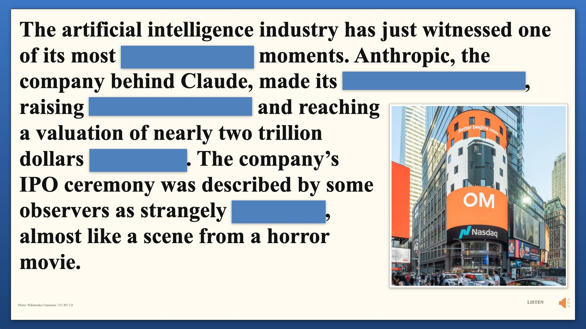
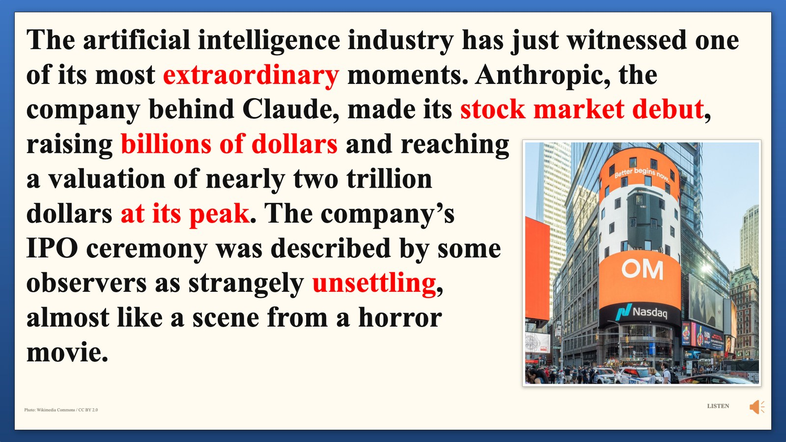

# listening-presentation

把一篇英语时文，自动做成一节可以直接上课的 **「Latest News」遮挡式听力课件**。

封面 + 3 页左右听力（听力词/短语被蓝色块遮住）+ 3 页答案（点一次消失一个色块）+ 可选视频页；免费男声 TTS 自动配音，音频、配图、动画全部内嵌进一个 16:9 的 `.pptx`。

这是给 DeepSeek Harness 的技能（skill），也可以脱离 DSH 单独当脚本用。

---

## 效果

| 封面 | 听力页（词被遮住） | 答案（全露出示意） |
|---|---|---|
|  |  |  |

- 版面：20 × 11.25 in（16:9），米白纸张 + 深蓝渐变底，复用示例课件的「Latest News」叠纸封面。
- 正文：Times New Roman Bold 54pt，开头几行通栏，之后收窄绕开右侧图片。
- 听力词：红色 `#FF0000`，被主题蓝 `#4F81BD` 矩形遮住；**单词和 2–3 词短语混搭**。
- 答案：与听力页逐页同版式，每个色块一条独立「点击消失」动画。
- 音频：`edge-tts` 免费 TTS，男/女声 + 美/英/澳/加/印多口音可选（默认 `en-US-AndrewNeural`，`+3%`），段间留 0.8s，开始条件为**单击时**（点喇叭图标播放）。

## 特性

- **完全可编辑**：不是整页图片，文字、色块、图片、音频都是原生 PPT 对象。
- **遮罩按渲染实测校准**：先出无遮罩版，扫描红色词块得到真实 bbox，再画遮罩——不露红边、不盖标点。
- **短语也能遮**：`stock market debut`、`at its peak` 这类短语作为整体换行、整体遮挡。
- **自动排满**：构建时按页计算 `fill%`，低于 88% 自动放大字号（最多 +6pt）并打印 `too empty` 警告；分页目标 88–98%，不留半页空白。
- **免费 TTS**：不花钱、不需要 API key，本机合成。
- **可选视频**：给链接或文件就下载、转 H.264、裁黑边、内嵌到最后一页。
- **可复现**：一条命令从 `deck.json` 到成片。

## 安装到 DSH

```bash
git clone https://github.com/TaKroslin/listening-presentation.git
cp -R listening-presentation ~/.dsh/skills/
```

或直接把本目录（含 `SKILL.md`）放进 `~/.dsh/skills/listening-presentation/`，DSH 会在下一步把它加入技能目录。

## 快速开始

### 1. 依赖

- Python 3.10+，`pip install -r requirements.txt`
- `ffmpeg` / `ffprobe`（音频拼接、视频转码）
- `officecli`（渲染校准、`validate`、逐页截图；没有也能出片，只是遮罩用近似坐标）

```bash
python3 -m venv .venv
.venv/bin/pip install -r requirements.txt
# TTS 单独装在同一个环境即可：
.venv/bin/pip install edge-tts
```

### 2. 生成示例课件

```bash
cd examples/anthropic-ai-ipo

PYTHON=$(which python3) ../../scripts/make_deck.sh deck.json example.pptx
```

`make_deck.sh` 做三件事：

1. 生成无遮罩版 → 逐页渲染；
2. 扫描红色词块，实测每个词/短语的 bbox，写出 `masks.json`；
3. 用实测坐标重建带遮罩、带答案动画的成片。

> `PYTHON` 要指向装了 `python-pptx / Pillow / numpy` 的解释器。
> 只改文案、没换字体字号时，也可以直接：
> `python scripts/build_deck.py --spec deck.json --out out.pptx`

### 3. 只做音频

```bash
python scripts/make_audio.py \
  --text article.txt --out audio.mp3 \
  --voice en-US-AndrewNeural --rate=+3% \
  --note "Listen to the news report." --paragraph-gap 0.8
```

### 配音选项

所有音色都来自 edge-tts，免费、无需 key。**开工前会先让你选**（声音 + 语速），不选就按默认 A / `+3%`。

| key | 音色 | 性别 | 口音 | 特点 |
|---|---|---|---|---|
| A | `en-US-AndrewNeural` | 男 | 美音 | 温暖自然（默认） |
| B | `en-US-ChristopherNeural` | 男 | 美音 | 新闻主播 |
| C | `en-US-GuyNeural` | 男 | 美音 | 情绪饱满 |
| E | `en-GB-RyanNeural` | 男 | 英音 | 友好清晰 |
| G | `en-AU-WilliamMultilingualNeural` | 男 | 澳音 | 轻松 |
| I | `en-IN-PrabhatNeural` | 男 | 印度音 | 清晰 |
| J | `en-US-AriaNeural` | 女 | 美音 | 新闻、积极 |
| K | `en-US-JennyNeural` | 女 | 美音 | 亲切 |
| L | `en-US-AvaNeural` | 女 | 美音 | 生动 |
| N | `en-GB-SoniaNeural` | 女 | 英音 | 端庄 |
| P | `en-AU-NatashaNeural` | 女 | 澳音 | 友善 |
| Q | `en-IN-NeerjaNeural` | 女 | 印度音 | 清楚 |

完整 17 个（含 Brian / Thomas / Liam / Libby / Emma）随时可查：

```bash
python scripts/make_audio.py --list-voices
```

语速：`-8%` 慢 / `-3%` 稍慢 / `+0%` 正常 / `+3%` 稍快（默认）/ `+8%` 快。

## 输入：`deck.json`

```json
{
  "title": "Anthropic's Two-Trillion-Dollar Debut Raises Uncomfortable Questions",
  "cover_image": "img/cover.jpg",
  "cover_credit": "Photo: TechCrunch / CC BY 2.0",
  "audio": "audio.mp3",
  "audio_icon": "../../assets/audio-icon.png",
  "body_size": 54,
  "pages": [
    {
      "text": "The artificial intelligence industry has just witnessed one of its most extraordinary moments. ...",
      "targets": [
        {"word": "extraordinary", "gloss": "非凡的"},
        {"word": "stock market debut", "gloss": "上市首秀"},
        {"word": "at its peak", "gloss": "在顶峰"}
      ],
      "image": "img/nasdaq.jpg",
      "credit": "Photo: Wikimedia Commons / CC BY 2.0"
    }
  ],
  "video": null
}
```

字段说明见 [`references/spec.md`](references/spec.md)。要点：

- `targets[].word` 可以是**单词或连续短语**；只遮第一次出现。
- 短语作为整体换行、整体遮挡，长度建议 1–3 词。
- 选词面向高中生：短语 + 进阶词混搭，避开 valuation / geopolitical / accountability 这类专业行话。
- `body_size` 默认 54，放不下会自动缩小（3 页方案常见 54 / 50 / 50）。

## 设计规范（节选）

| 项 | 值 |
|---|---|
| 画布 | 20 × 11.25 in |
| 纸张 | `#FFFBF0`，1.4pt 黑边，柔和投影 |
| 正文 | Times New Roman Bold 54pt / 行距 single |
| 听力词 | `#FF0000` |
| 遮罩 | `#4F81BD`，无边框 |
| 图片 | 右侧约 30%，近方形裁切，白边 + 细灰线 |
| 页填充 | 88–98%（构建日志 `fill%`，低于 88% 警告） |
| 音频开始 | 单击时（点喇叭图标，`<p:spTgt/>`） |
| 答案动画 | 每色块一个 `clickEffect`，`presetID=2 / exit / subtype=4`，500ms |

## 目录结构

```
.
├── SKILL.md                  # DSH 技能说明
├── README.md
├── requirements.txt
├── LICENSE
├── assets/audio-icon.png     # 喇叭图标
├── scripts/
│   ├── build_deck.py         # deck.json → PPTX
│   ├── make_audio.py         # edge-tts 分段合成 + 静音 + loudnorm
│   ├── calibrate_masks.py    # 渲染图 → 实测遮罩 bbox
│   ├── make_deck.sh          # 一条龙：无遮罩渲染 → 校准 → 成片
│   └── render.sh             # 逐页渲染（绕开 officecli 路径缓存）
├── references/spec.md        # 字段、常量、排障
├── examples/
│   └── anthropic-ai-ipo/     # 完整示例：spec + 素材 + example.pptx
└── docs/screenshots/
```

## 示例

[`examples/anthropic-ai-ipo/`](examples/anthropic-ai-ipo/) 是一篇关于 Anthropic 上市的时文：

- 3 页听力 + 3 页答案，5 / 5 / 6 个遮挡目标（词与短语混搭）
- 男声 TTS，86.7s
- 图片来自 Wikimedia Commons（CC / Public Domain），来源见 `CREDITS.md`
- `example.pptx` 是最终成片（不含视频页；视频需自行提供）

> 原始参考课件（`时文听力` 里的新闻课件）属于课堂内部素材，涉及第三方新闻图片与视频，未随仓库分发。

## 已知限制

- 遮罩校准依赖 `officecli` 的渲染结果；没有它时会退回字体宽度估算，可能出现 1–2px 偏差。
- 视频不自动播放：插入后默认点击播放（可在 PowerPoint「播放」选项卡里改成自动）。
- 字体不嵌入：依赖系统有 Times New Roman / Georgia；没有 Georgia 时封面会回退。

## License

代码以 [MIT](LICENSE) 许可开源。

示例内容：
- 文章：用户提供的课堂文本；
- 图片：Wikimedia Commons，具体作者与许可见 [`examples/anthropic-ai-ipo/CREDITS.md`](examples/anthropic-ai-ipo/CREDITS.md)；
- 音频：本仓库用 edge-tts 本地合成。

## 致谢

- 版式来源：`时文听力` 系列课件的「Latest News」模板
- TTS：[edge-tts](https://github.com/rany2/edge-tts)
- 渲染与校验：officecli
